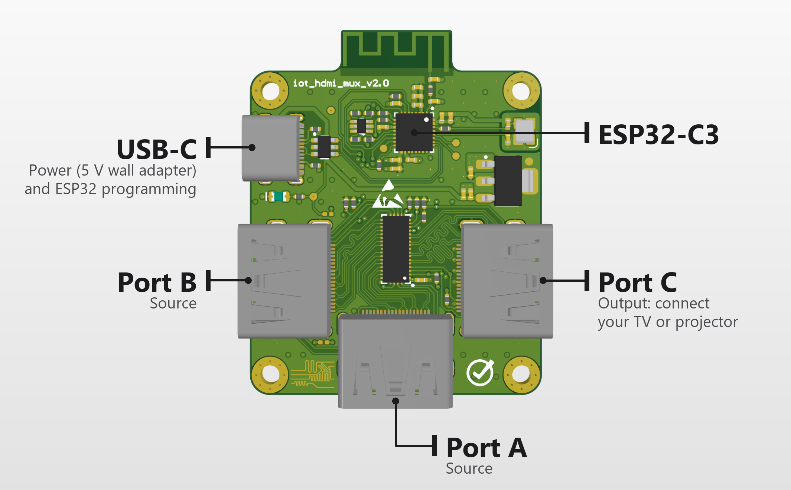

# IoT HDMI Switch: owner's manual (ESPHome firmware)

A 2-input, 1-output HDMI 2.0 switch (4K @ 60 Hz) that appears in Home Assistant as a
native ESPHome device. No cloud, no subscription, no custom integration to install.

This document covers the ESPHome firmware for the v2.0 board. If you just want to switch
inputs from Home Assistant, read [Setup](#setup) and stop there. Everything after
[CEC](#cec-control) is optional.

---

## What you get

- **Input switching from Home Assistant**: one `select` entity with `Off`, `Input A`,
  `Input B`. Drive it from the dashboard, a script, a voice assistant, or any automation.
- **Remembers its input across a power cut.** After an outage the switch returns to
  whatever it was showing, rather than coming back dark.
- **A CEC remote**: navigation, transport and volume keys you can aim at a source, the
  TV, or an AV receiver, all from Home Assistant.
- **Over-the-air updates**, both pushed from your own ESPHome install and pulled from the
  project's public update channel.
- **Local web interface** at the device's IP address, for control without Home Assistant.

---

## Setup

### 1. Connect



| Port | Connect to | Shown in Home Assistant as |
| --- | --- | --- |
| **Port A** | a source (streaming stick, console, player) | `Input A` |
| **Port B** | a second source | `Input B` |
| **Port C** | your TV, projector or AV receiver | |
| **USB-C** | a 5 V USB wall adapter (not included) | |

Both source devices can stay plugged in permanently. Only the selected one is routed to
the display.

### 2. Join it to your WiFi

On first boot the switch has no network, so it starts its own:

1. Look for the WiFi network **`Hdmi-Switch Fallback Hotspot`** and join it. The password
   is **`HDMI_SWITCH`**.
2. A setup page opens automatically. If it does not, browse to <http://192.168.4.1>.
3. Pick your home WiFi network, enter its password, save.

The switch reboots and joins your network. The hotspot reappears any time the switch
cannot reach your WiFi, so you can always get back in to change the network.

### 3. Adopt it in Home Assistant

Home Assistant discovers the switch automatically within a minute or two:

**Settings > Devices & Services**, where a new **ESPHome** device named **HDMI Switch**
is waiting under "Discovered". Click **Configure**, then **Submit**. There is no key or
password to paste.

If it is not discovered, add it manually with **Add Integration > ESPHome** and enter the
switch's IP address (port 6053).

### 4. Use it

The **HDMI Switch** select entity is now on your dashboard with `Off`, `Input A`,
`Input B`. That is the whole product. Everything below is optional.

A typical automation, switching the input when a source starts playing:

```yaml
triggers:
  - trigger: state
    entity_id: media_player.living_room_chromecast
    to: "playing"
actions:
  - action: select.select_option
    target:
      entity_id: select.hdmi_switch_hdmi_switch
    data:
      option: "Input A"
```

Check the exact `entity_id` on the device page, since it depends on the name you gave the
device when adopting it.

This is also the **recommended** way to get automatic input switching. It is more reliable
than CEC, and it works with any device Home Assistant can see, including devices with no
CEC support at all.

---

## What this does not do

**No buttons on the unit.** Input selection is over the network only. If your WiFi or
Home Assistant is down, you cannot change input. This is a deliberate choice for a Home
Assistant accessory, but it is worth knowing before it is the only thing between you and
the other console.

**Automatic switching only works from the source that is already on screen.** A source on
the other input is asleep until it is selected, so it cannot ask for the switch. Use a Home
Assistant automation instead.

---

## CEC control

CEC is the protocol HDMI devices use to talk to each other: it is what lets a streaming
stick turn your TV on, or a TV remote pause a player. This switch sits on that bus and
can send those messages for you.

You do not have to use any of it. Skip this whole section if you only want input
switching.

### Teach it which device is on which port

CEC devices identify themselves by number, not by which socket they are plugged into, so
the switch has to be told once which device is on which port. It takes about ten seconds
and it is remembered permanently, including across power cuts.

For each port:

1. Select that input (`Input A`) so the device is on screen.
2. Make sure the device is actually powered on, not asleep.
3. Press **Learn Port A**.

Check **CEC Learn Status** for the result:

| Reading | Meaning |
| --- | --- |
| `Port A = LA 4` | Bound. Done. |
| `Port A: no source seen, select that input and retry` | The switch heard nothing from that device. Make sure it is on and on screen, wake it with its own remote, and retry. |
| `Restored: A=LA 4 B=LA 1` | Shown after a reboot, confirming the saved bindings. |
| `No ports learned yet` | Shown after a reboot when nothing has ever been bound. |

Repeat for **Learn Port B**. To rebind later (you swapped a device), just press Learn
again with the new device on screen.

Some devices do not speak CEC at all, or ship with it turned off under a vendor brand
name (Anynet+, Bravia Sync, Simplink, Viera Link, AquosLink). If Learn cannot see a
device, check that first.

### The remote

**CEC Target** decides which device every remote button drives, universal-remote style:

| Target | Drives |
| --- | --- |
| `Source (auto)` *(default)* | whichever learned source is currently on screen |
| `Source A` / `Source B` | that source specifically, on screen or not |
| `TV (LA 0)` | the display |
| `Audio System (LA 5)` | an AV receiver or soundbar |
| `Sink (auto)` | the display if it speaks CEC, otherwise the audio system |

Then use the buttons: **Up**, **Down**, **Left**, **Right**, **Select**, **Back**,
**Home**, **Play**, **Pause**, **Stop**, **Rewind**, **Fast Forward**, **Previous**,
**Next**, **Volume Up**, **Volume Down**, **Mute**.

Volume keys usually want `Sink (auto)` (your TV or receiver controls the volume), while
navigation usually wants `Source (auto)`. Change the target from an automation like any
other select if you want both without touching it.

**TV On** wakes the TV and makes it show the switch's input, the same as pressing
play on a CEC player. The device on the selected input then takes over the remote.

**All Standby** tells every CEC device on the bus, TV included, to go to sleep. Handy as
a "switch everything off" button in a good-night scene.

**Sources Standby** asks only the two learned sources to sleep and leaves the TV on.
Whether a source obeys a standby that does not come from the TV is up to the source.

Not every device implements every key. Which ones work is up to the device, not the
switch.

---

## Entity reference

All entities are prefixed with the device name you chose when adopting it.

### Controls

| Entity | What it does |
| --- | --- |
| **HDMI Switch** (select) | `Off` / `Input A` / `Input B`. The main control. |
| **CEC Target** (select) | Which device the remote buttons drive. |
| **Learn Port A** / **Learn Port B** | Bind the on-screen device to that port. |
| **TV On** | Wake the TV and show this input. |
| **All Standby** | Tell every CEC device, TV included, to sleep. |
| **Sources Standby** | Ask the learned sources to sleep, TV stays on. |
| **Request Active Source** *(diagnostic)* | Make the real source re-claim the remote. |
| **CEC** *(17 buttons)* | Remote keys. See [The remote](#the-remote). |
| **Firmware** (update) | Offers new firmware when published. |

### Diagnostics

These live under "Diagnostic" on the device page. You never need them unless something
is not behaving.

| Entity | Reading | Meaning |
| --- | --- | --- |
| **CEC Role** | `TV` | No CEC-capable display was found, so the switch is standing in as the display. Normal with a projector or a monitor. |
| | `Source: CEC TV present` | Your TV speaks CEC and the switch is working alongside it. Normal with a modern TV. |
| | `Passive: no free CEC address` | The bus is full (rare, needs many CEC devices). The switch listens but cannot send. Remote keys will not work. |
| **CEC Sources** | `4:Chromecast->A 1:Kodi->B` | Devices seen on the bus, their names, and which port each is bound to. `->?` means seen but not yet learned. `none` means no CEC traffic at all. |
| **CEC Learn Status** | | Result of the last Learn press. See [the table above](#teach-it-which-device-is-on-which-port). |
| **CEC Physical Address** | `1.0.0.0` | The HDMI address your display advertises. Confirms the switch can read the display's EDID. |
| **CEC Log** | | Every CEC message, live. **Disabled by default**, and it should stay that way: it writes to your Home Assistant database continuously. Enable it only while debugging, then disable it again. |
| **CEC Ping TV** (button) | | Asks the display whether it is on. A reply proves the display will actually hold a conversation with the switch, so remote keys that do nothing are the display's own policy rather than a fault. Useful when setting up a new TV. |

---

## Updates

**Pushed** (you run ESPHome): edit the YAML, compile, upload.

**Pulled** (you do not run ESPHome): the **Firmware** entity checks the project's update
channel every 6 hours and offers new releases in Home Assistant, the same as any other
update. Click install.

---

## For tinkerers

The firmware is plain ESPHome. `iot_hdmi_mux_v2.0.yaml` builds it, and the vendored CEC
component sits in `components/`.

Two Home Assistant actions expose the CEC bus directly, so you can send anything without
rebuilding:

```yaml
# A remote key not covered by the buttons (here: the "1" key).
action: esphome.hdmi_switch_send_cec_key
data:
  dest: 4       # logical address: 0 = TV, 4/8/11 = players, 5 = audio system
  key: 0x21     # CEC UI command code, HDMI 1.4b table 27
```

```yaml
# Any CEC frame (here: System Audio Mode Request).
action: esphome.hdmi_switch_send_cec_frame
data:
  destination: 5
  data: [0x70, 0x00]
```